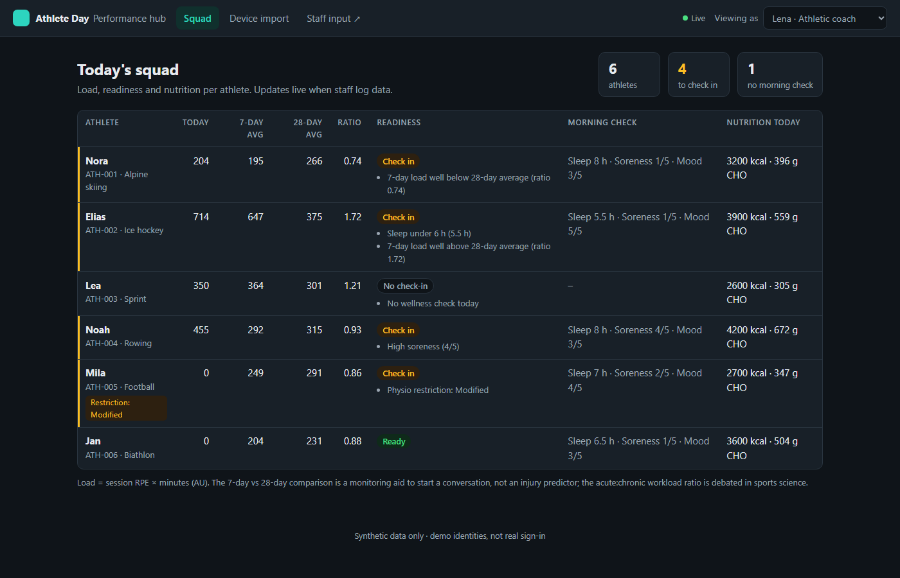
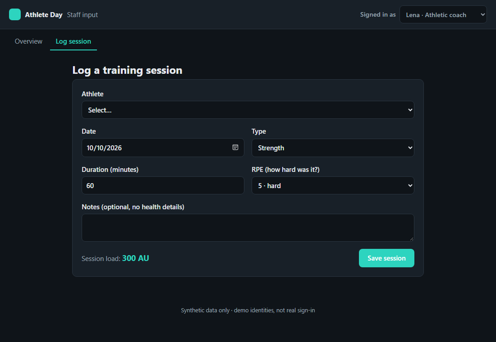
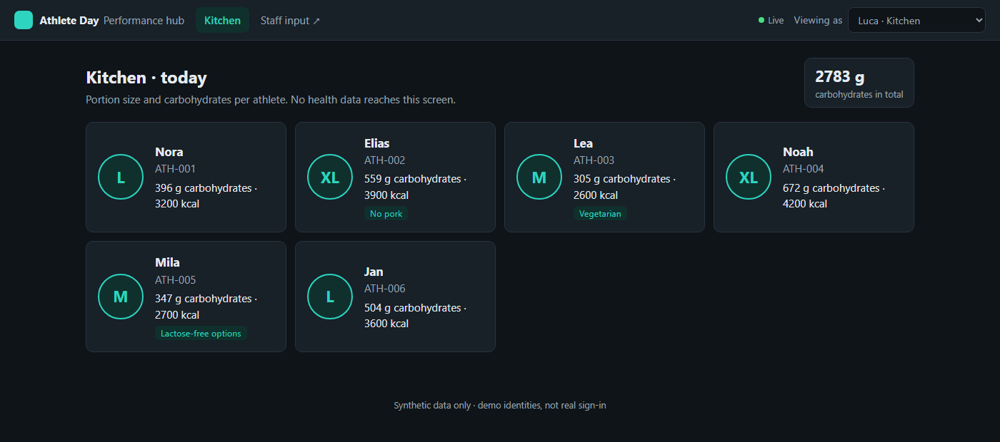
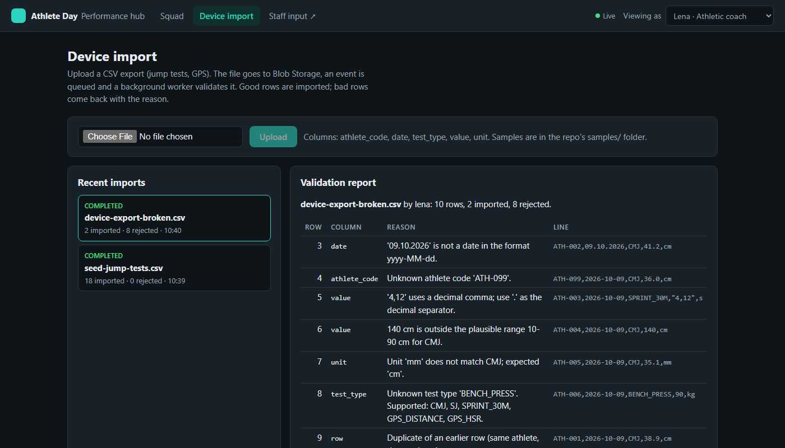

# Athlete Day: an interdisciplinary performance hub

A small full-stack demo of **one athlete's day, seen by every discipline, with each seeing only what it should.**
The athletic coach logs sessions, athletes do a morning wellness check, nutrition sets daily targets, the physio keeps
health notes, and the kitchen gets portions without any health data. Device exports (jump tests, GPS) come in through an
event-driven import with a row-by-row validation report.

> **Synthetic data only.** All athletes are invented, identified by pseudonymous codes (ATH-001 …). The app uses no
> real names, logos or organisations.

| Squad dashboard (Angular) | Staff input (Blazor) |
|---|---|
|  |  |
| **Kitchen view: no health data** | **Device import: validation report** |
|  |  |

## Documentation

| Document | For |
|---|---|
| [Reviewer guide](docs/REVIEWER-GUIDE.md) | Reviewing the code: how to run it, reading order, main flows, security, known limitations |
| [Spec-driven development](docs/spec/SPEC-DRIVEN-DEVELOPMENT.md) | How a change goes from requirement to merged code, and how AI automation could support it |
| [Requirements](docs/spec/requirements.md) · [OpenAPI contract](docs/spec/openapi.json) · [Decisions](docs/spec/decisions.md) | The specification itself |

## Stack

| Layer | Technology |
|---|---|
| API | ASP.NET Core 10 minimal API, built-in request validation, OpenAPI + Scalar, ProblemDetails |
| Data | SQL Server · **EF Core 10** for writes and migrations · **Dapper + hand-written T-SQL** for the dashboard report |
| Staff input | **Blazor WebAssembly**, sharing the validation rules with the API through a contracts project |
| Dashboard | **Angular 21**: standalone components, signals, zoneless, lazy routes, Vitest |
| Events | Azure **Blob Storage** + **Storage Queue** (Azurite locally) → background worker; **SignalR** live updates |
| Security | Role-based policies per discipline, audit log of who viewed health data |
| Quality | xUnit unit tests, integration tests with `WebApplicationFactory` against a real SQL Server (**Testcontainers** in CI) |
| Delivery | GitHub Actions (build, tests, Docker images), Docker Compose for one-command start |

## Spec-driven development

The specification in [`docs/spec/`](docs/spec/) is the source of truth:
[requirements with numbered acceptance criteria](docs/spec/requirements.md), the
[OpenAPI contract](docs/spec/openapi.json) and [architecture decisions](docs/spec/decisions.md).
Every change goes **spec → failing tests → code**, one commit each, on a feature branch with a PR.

CI enforces it: a traceability check fails if an acceptance criterion has no test (or a test names an unknown one), and a
contract test fails if the API drifts from `openapi.json`. v1.0 of the spec was written after the first implementation
to set a baseline; everything after it follows the workflow. Details: [docs/spec/README.md](docs/spec/README.md).

## Architecture

```
 Blazor WASM (staff input) ──┐                         ┌──► SQL Server
                             │   ASP.NET Core API      │      EF Core (writes) / Dapper + T-SQL (dashboard)
 Angular (dashboard) ────────┼──► policies · audit ────┤
         ▲                   │   validation            ├──► Blob Storage ── file
         │ SignalR "changed" │                         └──► Storage Queue ── ImportFileUploaded event
         └───────────────────┘                                   │
                                     ImportWorker (BackgroundService) ◄┘ validate → import good rows → report bad rows
```

* **Reads vs writes.** EF Core handles writes and migrations; the dashboard is a single Dapper query with CTEs that returns
  every athlete's 7- and 28-day load windows, today's wellness, nutrition and current restriction in one round trip.
* **Event-driven import.** Upload → raw file to Blob Storage → `ImportFileUploaded` on a queue → worker validates and
  imports. The worker only depends on the queue, so it can move to an Azure Function unchanged. In Azure, Event Grid can
  publish the BlobCreated event into the same queue; Azurite has no Event Grid, so the API publishes it here.
* **Idempotent consumer.** Queues deliver at least once; a job that is no longer `Queued` is skipped.
* **Live updates without leaking data.** SignalR only says *"something changed"*. Each client reloads through the API
  with its own role, so the push channel never carries health data.

## Privacy by design

| Role | Can do | Cannot see |
|---|---|---|
| Coach | Log sessions, squad dashboard, device import, add/edit/archive athletes | Physio note text |
| Athlete | Submit **their own** morning check | Anyone else's data |
| Nutrition | Set energy/carb targets, dashboard, kitchen view | Physio note text |
| Physio | Health notes and restrictions, dashboard, import | – |
| Kitchen | Portion size, carbs (g), kitchen note | Load, wellness, age, sex, any health data |
| Admin | Audit log | – |

* The kitchen endpoint returns a DTO that **has no field** for health data; an integration test checks the exact JSON shape.
* Every view of health-related data (dashboard, trends, physio notes) and every squad change is written to an **audit log**.
* Athletes are **archived, not deleted**: hidden everywhere, history kept, restorable (*Undo*). Only the birth year is
  stored, not the birth date (data minimisation, ADR-07 and ADR-08).
* Identity is a demo persona switcher (`X-Demo-User` / `X-Demo-Role` headers). In production the handler is replaced by
  Entra ID (JWT bearer); the policies and endpoints stay the same.

## Sports-science honesty

* **Load** = session RPE (Borg CR-10) × minutes, in arbitrary units (Foster's session-RPE).
* The **7-day vs 28-day comparison** is shown as a *monitoring aid to start a conversation*, not an injury predictor; the
  acute:chronic workload ratio is debated in the literature. Readiness flags list their reasons instead of a single score.

## Run it

### Option A: Docker (one command)

```bash
docker compose up --build
```
Dashboard http://localhost:8080 · Staff input http://localhost:8081 · API docs http://localhost:5080/scalar

### Option B: Locally on Windows, no Docker

Requires the .NET 10 SDK, Node 22.12+, and SQL Server LocalDB (installed with Visual Studio).

```powershell
.\scripts\start-local.ps1
```
Dashboard http://localhost:4200 · Staff input http://localhost:5090 · API docs http://localhost:5080/scalar

In Development the API applies migrations and **resets the synthetic data on every start**, so dates are always current.

### Tests

```powershell
dotnet test tests/AthleteDay.UnitTests
# Integration tests use Testcontainers (Docker). Without Docker, point them at any SQL Server:
$env:ATHLETEDAY_TEST_SQL = "Server=(localdb)\MSSQLLocalDB;Trusted_Connection=True;TrustServerCertificate=True"
dotnet test tests/AthleteDay.IntegrationTests

cd web/dashboard; npx ng test --watch=false
```

## Three-minute walkthrough

1. **Dashboard** as *Lena · coach*: sort by age, filter *Ice hockey*, search a name. Hover a **?** to explain a column.
2. **⋯ → Log session** on Lea: the staff form opens with Lea selected. Log 75 min at RPE 8; the form shows the load live.
3. **Dashboard**: the row updates without a refresh (SignalR). Elias shows a 7-day spike and short sleep → *Check in*, with reasons.
4. Switch persona to **Kitchen**: the app jumps to portions and carbs. Health data is not hidden in the UI; the API never sends it.
5. **Device import** as coach: upload `samples/device-export-broken.csv` → 2 rows imported, 8 rejected, each with column and reason.
6. **+ Add athlete**, then **⋯ → Archive** with confirmation and *Undo*. Show the **audit log** (Admin) and the green **CI run**.

## Project layout

```
src/AthleteDay.Contracts   DTOs + validation rules shared by API and Blazor
src/AthleteDay.Core        Pure logic: load, readiness, nutrition, CSV validation (unit-tested)
src/AthleteDay.Api         Minimal API, EF Core, Dapper report, auth policies, audit, import worker, SignalR
src/AthleteDay.Staff       Blazor WebAssembly staff input
web/dashboard              Angular dashboard
tests/                     xUnit unit + integration tests
samples/                   Valid and broken device CSV exports
```

## Next steps

* Deploy to **Azure App Service** from the pipeline (API + static frontends), Azure SQL, Storage; infrastructure as **Terraform**.
* Replace the demo personas with **Entra ID**; map app roles to the same policies.
* Route uploads through **Event Grid** (BlobCreated → queue) and move the worker to an Azure Function.
* Transactional outbox for the upload event, retention rules for health data, and row-level filtering per team.
