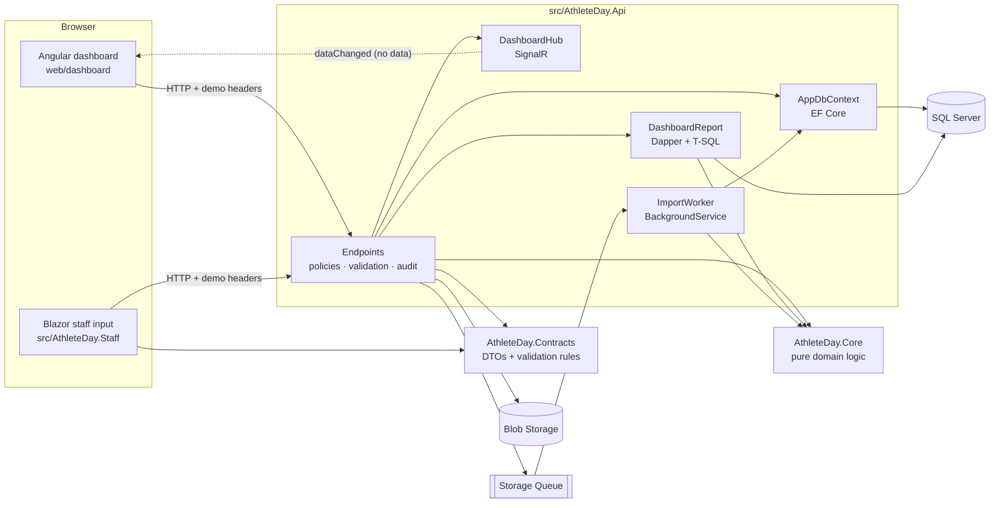
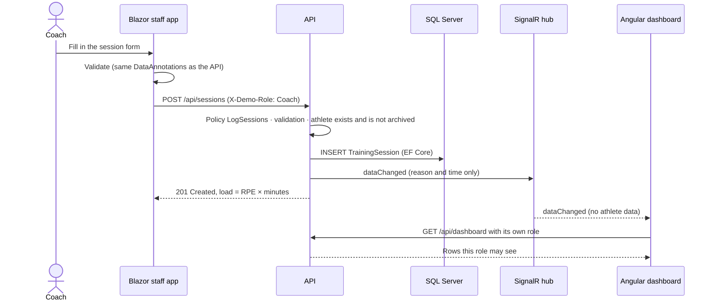
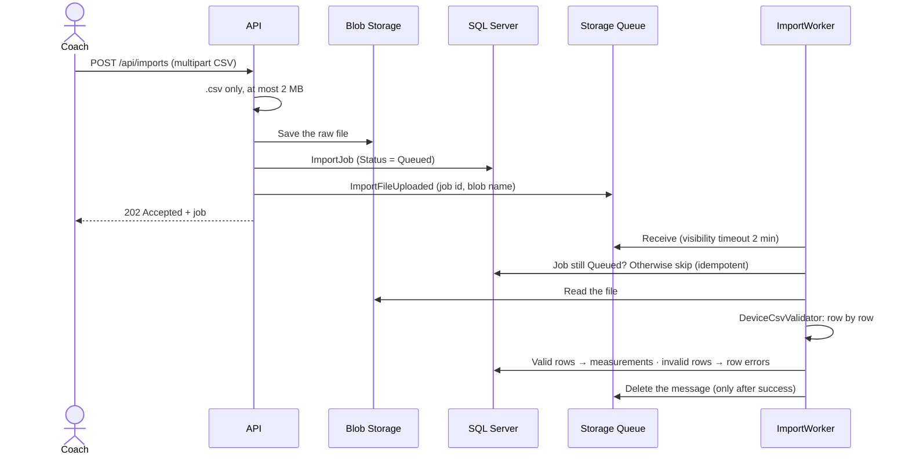

# Reviewer guide

A guided tour for reviewing Athlete Day: what to run, what to read in which order, how the main flows work, and
where the known weak spots are. Plan about 45 minutes for the tour, or 10 minutes for the
[short path](#short-path-10-minutes).

## Contents

1. [The app in two minutes](#1-the-app-in-two-minutes)
2. [Run it](#2-run-it)
3. [Map of the solution](#3-map-of-the-solution)
4. [Reading order](#4-reading-order)
5. [The four flows worth tracing](#5-the-four-flows-worth-tracing)
6. [Security and privacy: where each rule is enforced](#6-security-and-privacy-where-each-rule-is-enforced)
7. [Spec, tests and CI](#7-spec-tests-and-ci)
8. [Known limitations and open questions](#8-known-limitations-and-open-questions)
9. [Where to find what](#9-where-to-find-what)

---

## 1. The app in two minutes

An interdisciplinary team (athletic coach, physio, nutrition, kitchen) works on the same athletes. Athlete Day records
one athlete's day across these disciplines and shows each role **only what it needs**. The kitchen gets portions and
carbohydrates, never health data. Only the physio reads free-text health notes. Every view of health-related data is
audited.

**Synthetic data only.** All athletes are invented and identified by pseudonymous codes (ATH-001 …).

| Part | Technology | Purpose |
|---|---|---|
| API | ASP.NET Core 10 minimal API | Policies per discipline, validation, audit, OpenAPI |
| Data | SQL Server: EF Core 10 for writes, Dapper + T-SQL for the dashboard | One round trip for the whole squad |
| Events | Blob Storage + Storage Queue (Azurite locally), `BackgroundService` | Asynchronous device CSV import |
| Live updates | SignalR | The push says "something changed"; it carries no data |
| Staff input | Blazor WebAssembly | Fast forms; shares validation rules with the API |
| Dashboard | Angular 22 (standalone, signals, zoneless, Signal Forms) | Squad view, athlete trend, kitchen, imports, audit |
| Languages | English and German | Typed catalogues in Angular (`src/app/i18n`), `.resx` in each .NET project (`Resources/`), server texts follow `Accept-Language` (ADR-09) |
| Quality | xUnit, Testcontainers, Vitest, GitHub Actions | Spec traceability and an OpenAPI contract check in CI |

Scope is deliberately small. Identity is a demo persona switcher, not real sign-in, and nothing is deployed to Azure
(see [section 8](#8-known-limitations-and-open-questions)).

## 2. Run it

**With Docker (one command):**

```bash
docker compose up --build
```

| What | URL |
|---|---|
| Dashboard (Angular) | http://localhost:8080 |
| Staff input (Blazor) | http://localhost:8081 |
| API reference (Scalar) | http://localhost:5080/scalar |

**Without Docker (Windows, LocalDB):** `.\scripts\start-local.ps1`. The dashboard is then on port 4200 and staff input
on port 5090.

The demo data **resets on every API start**, with dates relative to today, so the dashboard always looks current.
Restart the API to undo anything you tried.

**Personas.** Switch with the *Viewing as* menu in the top right, or open a URL with `?as=<user>`:

| User | Role | Try this |
|---|---|---|
| `lena` | Coach | Sort by age, filter a sport, **⋯ → Archive** then *Undo*, **+ Add athlete** |
| `jonas` | Physio | Open an athlete: the physio notes appear, and the view is written to the audit log |
| `mia` | Nutrition | Squad and kitchen screens |
| `luca` | Kitchen | Only portions and carbohydrates; compare the JSON at `/api/kitchen/today` in Scalar |
| `admin` | Admin | The audit log, including the views you just caused |
| *(staff app)* Athlete | Athlete | In the staff app, pick *Athlete*, then any name: the morning check is sent for that athlete only |

To see a rejected import, upload [`samples/device-export-broken.csv`](../samples/device-export-broken.csv) as the
coach under *Device import*: 2 rows are imported and 8 rejected, each with a row, column and reason.

**Calling the API directly.** Send `X-Demo-User` and `X-Demo-Role` headers, for example:

```bash
curl -H "X-Demo-User: lena" -H "X-Demo-Role: Coach" http://localhost:5080/api/dashboard
```

## 3. Map of the solution



| Project | Depends on | Notes |
|---|---|---|
| [`AthleteDay.Contracts`](../src/AthleteDay.Contracts) | – | Request/response types, enums, DataAnnotations rules. Shared by the API and Blazor. |
| [`AthleteDay.Core`](../src/AthleteDay.Core) | Contracts | Pure functions: load, readiness, nutrition, CSV validation. No I/O, fully unit-tested. |
| [`AthleteDay.Api`](../src/AthleteDay.Api) | Core, Contracts | Everything with I/O: endpoints, EF Core, Dapper, storage, SignalR, worker. |
| [`AthleteDay.Staff`](../src/AthleteDay.Staff) | Contracts | Blazor WebAssembly forms. |
| [`web/dashboard`](../web/dashboard) | – (HTTP only) | Angular; [`models.ts`](../web/dashboard/src/app/api/models.ts) mirrors the C# contracts by hand. |

## 4. Reading order

Each step names the files and what is worth checking in them.

| # | Read | Look for |
|---|---|---|
| 1 | [`docs/spec/requirements.md`](spec/requirements.md) | Roles, domain rules (section 4), acceptance criteria AC-01 to AC-84. Everything below traces back here. |
| 2 | [`Program.cs`](../src/AthleteDay.Api/Program.cs) | The composition root: data, auth, storage adapters (Azure or in-memory), worker, SignalR, startup migration and seed. |
| 3 | [`Auth/Policies.cs`](../src/AthleteDay.Api/Auth/Policies.cs), [`Auth/DemoAuthenticationHandler.cs`](../src/AthleteDay.Api/Auth/DemoAuthenticationHandler.cs) | One policy per need, not per screen. The handler is the only part that changes for Entra ID. |
| 4 | [`Endpoints/`](../src/AthleteDay.Api/Endpoints) | `StaffInputEndpoints` (writes), `ReportEndpoints` (dashboard, kitchen DTO, audit), `AthleteEndpoints` (squad management), `ImportEndpoints` (upload). Note `TypedResults` and the `.Audited(...)` filter. |
| 5 | [`Reports/DashboardReport.cs`](../src/AthleteDay.Api/Reports/DashboardReport.cs) | The T-SQL: CTE `daily`, window sums with `CASE`, `OUTER APPLY` for the latest restriction, explicit archive filter. |
| 6 | [`AthleteDay.Core`](../src/AthleteDay.Core) | `LoadCalculator`, `ReadinessEvaluator` (reasons in words, no score), `NutritionCalculator`, `DeviceCsvValidator`. |
| 7 | [`Imports/`](../src/AthleteDay.Api/Imports) | `ImportInfrastructure` (ports and adapters), `ImportWorker` (receive → process → complete), `ImportProcessor` (idempotency check, partial import). |
| 8 | [`Audit/AuditFilter.cs`](../src/AthleteDay.Api/Audit/AuditFilter.cs), [`Realtime/DashboardHub.cs`](../src/AthleteDay.Api/Realtime/DashboardHub.cs) | Audit only on success; the push payload is `{ reason, at }`. |
| 9 | [`Data/AppDbContext.cs`](../src/AthleteDay.Api/Data/AppDbContext.cs), [`Data/Migrations/`](../src/AthleteDay.Api/Data/Migrations) | Enums as strings, the global query filter for archived athletes, indexes that cover the report. |
| 10 | [`Contracts/Requests.cs`](../src/AthleteDay.Contracts/Requests.cs) | The rules both the browser and the server enforce. |
| 11 | Angular: [`app.config.ts`](../web/dashboard/src/app/app.config.ts), [`api/`](../web/dashboard/src/app/api), [`pages/dashboard.page.ts`](../web/dashboard/src/app/pages/dashboard.page.ts), [`pages/squad-view.ts`](../web/dashboard/src/app/pages/squad-view.ts), [`pages/athlete-form.ts`](../web/dashboard/src/app/pages/athlete-form.ts) | Signals and `computed` for state, an `effect` that reloads on role switch or push, pure sort/filter logic, Signal Forms. |
| 12 | Blazor: [`Services/StaffApi.cs`](../src/AthleteDay.Staff/Services/StaffApi.cs), [`Components/ServerValidator.cs`](../src/AthleteDay.Staff/Components/ServerValidator.cs) | Server-side validation errors shown on the right form field. |
| 13 | Tests: [`ApiFactory.cs`](../tests/AthleteDay.IntegrationTests/ApiFactory.cs), [`ApiTests.cs`](../tests/AthleteDay.IntegrationTests/ApiTests.cs), [`SquadTests.cs`](../tests/AthleteDay.IntegrationTests/SquadTests.cs), [`ContractAndEventTests.cs`](../tests/AthleteDay.IntegrationTests/ContractAndEventTests.cs), [`SpecTraceabilityTests.cs`](../tests/AthleteDay.UnitTests/SpecTraceabilityTests.cs) | A real SQL Server per run, each test creates its own athletes, and the contract and traceability checks. |

Then [`docs/spec/decisions.md`](spec/decisions.md) (ADR-01 to ADR-14) gives the reasons behind the main choices.

### Short path (10 minutes)

1. [`Auth/Policies.cs`](../src/AthleteDay.Api/Auth/Policies.cs): who may do what.
2. [`Endpoints/ReportEndpoints.cs`](../src/AthleteDay.Api/Endpoints/ReportEndpoints.cs): the kitchen DTO with no field for health data.
3. [`Reports/DashboardReport.cs`](../src/AthleteDay.Api/Reports/DashboardReport.cs): the read side in one query.
4. [`Imports/ImportProcessor.cs`](../src/AthleteDay.Api/Imports/ImportProcessor.cs): the idempotent consumer.
5. [`docs/spec/decisions.md`](spec/decisions.md): the trade-offs.

## 5. The four flows worth tracing

### 5.1 A coach logs a session, and open dashboards update



Code: [`StaffInputEndpoints.LogSession`](../src/AthleteDay.Api/Endpoints/StaffInputEndpoints.cs) →
[`DashboardNotifier`](../src/AthleteDay.Api/Realtime/DashboardHub.cs) →
[`realtime.service.ts`](../web/dashboard/src/app/api/realtime.service.ts) bumps a `version` signal →
the `effect` in [`dashboard.page.ts`](../web/dashboard/src/app/pages/dashboard.page.ts) reloads.

**Why the push carries no data (ADR-05):** sending rows over SignalR would bypass per-role authorization. One extra
GET per change is the price.

### 5.2 The dashboard read: one query for the whole squad

`GET /api/dashboard` runs one T-SQL statement through Dapper (ADR-01). It returns each athlete's load today, the 7- and
28-day sums, today's wellness check, today's nutrition target and the latest physio restriction. C# then turns the sums
into averages and a ratio, and builds readiness reasons with the pure functions in `AthleteDay.Core`.

Why not EF Core here: the rolling windows and the "latest restriction per athlete" lookup are clearer and more
predictable as hand-written SQL. A covering index on `TrainingSessions (AthleteId, Date)`, including `Rpe` and
`DurationMinutes`, supports the query. AC-12 checks the window edges against a real SQL Server.

### 5.3 Device import: upload → blob → queue → worker



Code: [`ImportEndpoints.Upload`](../src/AthleteDay.Api/Endpoints/ImportEndpoints.cs),
[`ImportWorker`](../src/AthleteDay.Api/Imports/ImportWorker.cs),
[`ImportProcessor`](../src/AthleteDay.Api/Imports/ImportProcessor.cs),
[`DeviceCsvValidator`](../src/AthleteDay.Core/DeviceCsvValidator.cs).

- **At-least-once delivery.** A message is deleted only after it was processed. If the worker crashes, the message
  becomes visible again; the `Queued` status check makes the second delivery a no-op (AC-30).
- **Partial import.** Good rows are kept, and bad rows are reported with row number, column and reason, instead of
  rejecting the whole file. A wrong header or an empty file still fails the whole file (AC-25).
- **Azure path.** The worker only knows `IImportEventQueue`, so it can move to an Azure Function unchanged. In Azure,
  Event Grid would publish `BlobCreated` into the same queue; Azurite has no Event Grid, so the API publishes the event
  itself (ADR-04).
- **Tests** run with in-memory adapters (a `Channel` and a dictionary), so the full path runs without Azure.

### 5.4 Archive an athlete, with Undo

`DELETE /api/athletes/{id}` sets `ArchivedAt` instead of deleting the row (ADR-07). An EF Core **global query filter**
(`ArchivedAt == null`) then hides the athlete from every EF query: lists, `FindAsync` in the staff forms, and the
known-codes lookup of the import. The Dapper report has no access to EF filters, so its SQL filters explicitly. Restore
and the archive list opt out with `IgnoreQueryFilters()`.

In the UI, *Archive* asks for confirmation, and the confirmation toast offers *Undo*, which calls `POST …/restore`.
AC-35 checks that the athlete disappears from the dashboard, the athlete list and the kitchen; that new sessions are
rejected; that the history is kept; and that restore brings everything back.

## 6. Security and privacy: where each rule is enforced

**Authorization is enforced in the API; the UI only hides what a role cannot use.** Every `/api` route requires an
identity (AC-01); each endpoint additionally requires one policy.

| Policy | Roles | Endpoints | Audited |
|---|---|---|---|
| `ReadAthletes` | Coach, Physio, Nutrition, Athlete | `GET /api/athletes` | – |
| `ViewDashboard` | Coach, Physio, Nutrition | `GET /api/dashboard`, `GET /api/athletes/{id}`, `…/load-trend`, `…/sessions`, `…/measurements`, `…/progress`, `…/benchmarks` | Dashboard and the per-athlete reads |
| `LogSessions` | Coach | `POST /api/sessions` | – |
| `SubmitWellness` | Athlete (own data only, checked in code) | `PUT /api/wellness` | – |
| `SetNutrition` | Nutrition | `PUT /api/nutrition-targets` | – |
| `ViewKitchen` | Kitchen, Nutrition | `GET /api/kitchen/today` | – |
| `HealthNotes` | Physio | `GET /api/athletes/{id}/physio-notes`, `POST /api/physio-notes` | Yes |
| `ImportDeviceData` | Coach, Physio | `/api/imports` (upload, list, report) | – |
| `ManageSquad` | Coach | `POST/PUT/DELETE /api/athletes…`, `…/restore`, `…/archived` | Changes |
| `ViewAudit` | Admin | `GET /api/audit` | – |
| `WellnessHistory` | Coach, Physio | `GET /api/athletes/{id}/wellness` | Yes |
| `ReadSports` | Coach, Physio, Nutrition, Athlete, Admin | `GET /api/sports` | – |
| `ManageSports` | Admin | `POST /api/sports`, `PUT /api/sports/{id}` | – |
| `CoachingNotes` | Coach, Physio | `GET …/session-notes`, `GET …/reviews` | Yes |
| `WriteCoaching` | Coach | Goals (`PUT`/`DELETE …/goals/{test}`), `POST /api/sessions/{id}/notes`, `POST …/reviews`, the plan (`PUT …/plan/template`, `PUT`/`DELETE …/plan/days/{date}`) | Changes |
| `ReadPlan` | Coach, Physio, Nutrition, Athlete (own plan only, checked in code) | `GET …/plan/week`, `GET …/plan/template` | – |

**Privacy by design (NFR-02).** A role's response shape has no field for data that role must not see.
`KitchenRowDto` cannot carry health data, and AC-20 asserts the exact JSON property list. Age and sex appear in
dashboard rows, never in the kitchen view. Only the birth year is stored (ADR-08).

**Audit.** [`AuditFilter`](../src/AthleteDay.Api/Audit/AuditFilter.cs) writes user, role, action
(`Viewed`/`Changed`), resource and athlete id after **successful** requests only, so the log answers "who has seen this
athlete's data?". The athlete id comes from the route, or, for a create, from the response
(`IAthleteScoped`). The Angular athlete page requests physio notes only for the physio role, so other roles do not
create audit noise.

**Tests to read for this section:** AC-01, AC-02, AC-09, AC-20, AC-22 and AC-36 in
[`ApiTests.cs`](../tests/AthleteDay.IntegrationTests/ApiTests.cs) and
[`SquadTests.cs`](../tests/AthleteDay.IntegrationTests/SquadTests.cs).

## 7. Spec, tests and CI

The spec is the source of truth ([`docs/spec/README.md`](spec/README.md)). Since v1.1, every change is three commits on a
feature branch: **spec → failing tests → code**. The squad management feature (spec v1.1 and v1.2 in the git history) is a full example.

| Level | Where | What it covers | Count |
|---|---|---|---|
| Unit | [`tests/AthleteDay.UnitTests`](../tests/AthleteDay.UnitTests) | Core logic, request validation, spec traceability, resource parity, progress, benchmark and plan rules | 94 |
| Integration | [`tests/AthleteDay.IntegrationTests`](../tests/AthleteDay.IntegrationTests) | The real API (`WebApplicationFactory`) against a real SQL Server, the import pipeline, SignalR, the OpenAPI contract | 99 |
| Angular | `web/dashboard/src/**/*.spec.ts` (Vitest) | Role-dependent screens, sorting and filtering, dialogs, the persona interceptor, the charts, the athlete space and its plan | 52 |
| Staff | [`tests/AthleteDay.Staff.Tests`](../tests/AthleteDay.Staff.Tests) (bUnit) | Blazor components with the real persona, headers handler and API client over a fake API | 10 |

Two checks keep the spec honest:

- **Traceability** ([`SpecTraceabilityTests`](../tests/AthleteDay.UnitTests/SpecTraceabilityTests.cs)): fails if an
  AC in `requirements.md` has no test, or a test names an AC that does not exist. C# tests use
  `[Trait("AC", "AC-05")]`; Angular tests put the ID in the name, e.g. `it('[AC-38] …')`.
- **Contract** (`Published_api_matches_the_committed_openapi_contract`): fails if the running API's OpenAPI document
  differs from [`docs/spec/openapi.json`](spec/openapi.json).

[CI](../.github/workflows/ci.yml) runs on every push and PR: .NET build → traceability → unit tests → integration
tests (Testcontainers SQL Server 2022) · Angular build and tests · Docker image build.

**Run everything locally:**

```powershell
dotnet test tests/AthleteDay.UnitTests
dotnet test tests/AthleteDay.Staff.Tests
# Integration tests start a SQL Server container (Docker). Without Docker, point them at LocalDB:
$env:ATHLETEDAY_TEST_SQL = "Server=(localdb)\MSSQLLocalDB;Trusted_Connection=True;TrustServerCertificate=True"
dotnet test tests/AthleteDay.IntegrationTests
cd web/dashboard; npx ng test --watch=false
```

## 8. Known limitations and open questions

What is deliberately simple, and where I would most like a reviewer's opinion.

**By design for a demo:**

- **Identity trusts headers.** Anyone who can reach the API can claim any role. The policies would stay the same with
  Entra ID (JWT bearer); only the handler changes (ADR-03).
- **The SignalR hub is not authenticated.** It carries only `{ reason, at }`, so nothing leaks, but in production it
  would require the same identity as the API.
- **The worker runs inside the API process.** It is easy to move out, because it depends only on the queue
  abstraction.
- **Not deployed to Azure.** Azurite stands in for Storage; there is no Terraform yet.

**Known gaps I would fix next:**

- **The upload is not atomic.** The API saves the blob, then the job, then publishes the event. If publishing fails,
  the job stays `Queued` forever. A transactional outbox, or Event Grid on `BlobCreated`, would close this.
- **"Today" differs slightly between validation and the clock.** Request validation uses the server's local date with
  one day of tolerance, while `AppClock` uses Europe/Zurich. This only matters around midnight on a server far from
  Zurich.
- **Archive is not erasure.** A right-to-erasure request (Swiss FADP / GDPR) would need a separate, audited admin
  action that also deletes the history (ADR-07).
- **The Angular models mirror the C# contracts by hand.** Generating them from `openapi.json` would remove the drift
  risk.

**Questions I would value input on:**

1. Would you keep the dashboard as one Dapper query as it grows, or move to a read model or materialised view?
2. Is per-team row-level filtering better placed in the policies, in the queries, or in SQL Server Row-Level Security?
3. For the import: Event Grid → queue → Azure Function, or Service Bus with sessions?

## 9. Where to find what

| Question | Answer | File |
|---|---|---|
| How is load calculated? | Session RPE (1–10) × minutes; 7- and 28-day averages count rest days as 0. | [`LoadCalculator.cs`](../src/AthleteDay.Core/LoadCalculator.cs) |
| When is an athlete flagged? | Sleep < 6 h, soreness ≥ 4, mood ≤ 2, ratio outside 0.8–1.3, or any physio restriction. Reasons are listed in words. | [`ReadinessEvaluator.cs`](../src/AthleteDay.Core/ReadinessEvaluator.cs) |
| What does the CSV validator check? | Header, athlete code, date format and not in the future, test type, number format and plausible range, unit, duplicates. | [`DeviceCsvValidator.cs`](../src/AthleteDay.Core/DeviceCsvValidator.cs) |
| How do Blazor and the API share validation? | DataAnnotations in Contracts; .NET 10 `AddValidation()` on the server, `DataAnnotationsValidator` in Blazor. | [`Requests.cs`](../src/AthleteDay.Contracts/Requests.cs) |
| How does a role switch reload the screen? | `PersonaService` is a signal; the page `effect` reads it and reloads. | [`persona.service.ts`](../web/dashboard/src/app/api/persona.service.ts) |
| How does an athlete sign in to the demo? | In the staff app, pick *Athlete*, then a name from the squad list; that code becomes the identity, and the API only accepts a morning check for it (AC-09, AC-50). | [`AthleteSignIn.razor`](../src/AthleteDay.Staff/Components/AthleteSignIn.razor) |
| Why is "today" Zurich time? | So a server in UTC does not shift the athletes' day. | [`AppClock.cs`](../src/AthleteDay.Api/Infrastructure/AppClock.cs) |
| How is demo data built? | Generated relative to today on every start, with one load spike, one sore athlete, one restriction and one missing check-in. | [`DemoDataSeeder.cs`](../src/AthleteDay.Api/Data/DemoDataSeeder.cs) |
| Why EF Core and Dapper? | EF Core for writes and migrations; Dapper where the SQL itself is the point. | [ADR-01](spec/decisions.md) |
| Where do texts and translations live? | Angular: `en.ts` and `de.ts` (German typed against English). .NET: `Resources/*.resx` per project; a test compares the languages (AC-54). | [`web/dashboard/src/app/i18n`](../web/dashboard/src/app/i18n) |
| How are athlete codes assigned? | Highest `ATH-` number + 1, inside a transaction that holds a SQL Server application lock, so parallel adds cannot pick the same code (AC-32). | [`AthleteEndpoints.cs`](../src/AthleteDay.Api/Endpoints/AthleteEndpoints.cs) |
