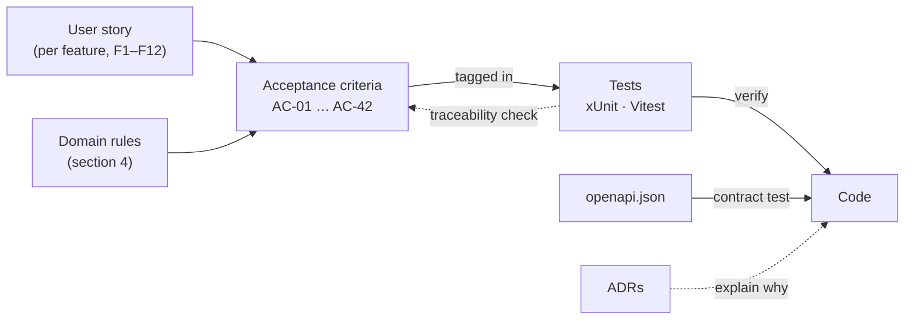
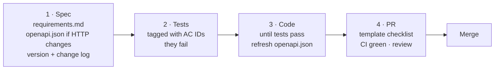
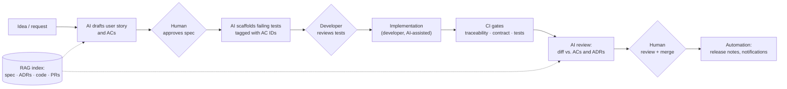
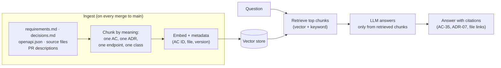

# Spec-driven development

How a change in Athlete Day goes from a requirement to merged code, which checks keep the specification and the code
in sync, and how AI automation could support each step.

Sections 1–7 describe how the repo works **today**. Section 8 is a **proposal**: none of the AI automation in it is
implemented yet.

## Contents

1. [Why spec-driven](#1-why-spec-driven)
2. [The artefacts and how they link](#2-the-artefacts-and-how-they-link)
3. [Writing acceptance criteria](#3-writing-acceptance-criteria)
4. [The workflow, step by step](#4-the-workflow-step-by-step)
5. [What CI enforces, and what it cannot](#5-what-ci-enforces-and-what-it-cannot)
6. [Worked example: v1.1 squad management](#6-worked-example-v11-squad-management)
7. [Conventions](#7-conventions)
8. [AI automation: a proposal](#8-ai-automation-a-proposal)

---

## 1. Why spec-driven

Athlete Day handles health-related data for several disciplines, and the most important rules are about **who may see
what**. Rules like "the kitchen never receives health data" are easy to state and easy to break by accident. Writing
them as numbered acceptance criteria (ACs) and requiring a test for each turns them into something CI can check on
every push.

The spec also gives reviewers and new team members one place to read what the system is supposed to do, separate from
how it does it.

## 2. The artefacts and how they link

| Artefact | File | Contains |
|---|---|---|
| Requirements | [`requirements.md`](requirements.md) | Roles, scope, domain rules (definitions and thresholds), functional requirements with numbered ACs, non-functional requirements, change log |
| HTTP contract | [`openapi.json`](openapi.json) | Every endpoint and schema of the API, exactly as the running API publishes it |
| Decisions | [`decisions.md`](decisions.md) | Architecture decision records (ADRs): context → decision → consequence |
| Tests | `tests/`, `web/dashboard/src/**/*.spec.ts` | Each test names the AC(s) it verifies |



## 3. Writing acceptance criteria

An AC is one row in a requirement's table: ID, criterion, and how it is verified (Unit, Integration or Angular).

**A good AC is:**

| Rule | Good (from this repo) | Not good enough |
|---|---|---|
| Observable from outside | "…the response is 201 and contains load = RPE × minutes." (AC-05) | "Load is stored correctly." |
| Exact about numbers and edges | "a ratio above 1.3 or below 0.8 is flagged, the band edges are not." (AC-13) | "Unusual ratios are flagged." |
| Explicit about roles | "kitchen → dashboard and athlete list; coach and nutrition → physio notes" (AC-02) | "Roles are restricted appropriately." |
| Testable at one named level | "Verified by: Integration" | No level, or "manual" |
| Free of implementation detail | "Deleting an athlete archives it…" (AC-35) | "Set `ArchivedAt` with a global query filter." (that belongs in an ADR) |

Definitions that several ACs share, such as *acute load* or *age*, go into the domain rules table (section 4 of the
requirements) instead of being repeated in each AC.

## 4. The workflow, step by step

Every change runs on a feature branch and is merged with a pull request. Each of the three steps is **its own commit**,
so the history shows the order.



1. **Spec.** Add or change ACs in `requirements.md`, bump the version, and add a change-log line. Add an ADR to
   `decisions.md` if the change involves an architectural choice. If the HTTP contract changes, describe the change
   in `openapi.json`.
2. **Tests.** Write the tests and tag them:
   - C#: `[Trait("AC", "AC-32")]` on the test method (several traits are allowed).
   - Angular: the ID in the test name, e.g. `it('[AC-38] sorts by a clicked column header …')`.

   They fail, or do not compile yet. That is expected.
3. **Code.** Implement until all tests pass. Then refresh the contract file from the running API and review the diff;
   it must contain exactly the change specified in step 1:

   ```powershell
   $env:UPDATE_OPENAPI_CONTRACT = "1"
   dotnet test tests/AthleteDay.IntegrationTests --filter "FullyQualifiedName~Published_api"
   ```

4. **Pull request.** The [PR template](../../.github/pull_request_template.md) asks for the affected ACs and a
   checklist. CI must be green before merging.

## 5. What CI enforces, and what it cannot

| Gate | Test | Fails when |
|---|---|---|
| Traceability | [`SpecTraceabilityTests`](../../tests/AthleteDay.UnitTests/SpecTraceabilityTests.cs) (`Category=Spec`) | An AC in `requirements.md` has no tagged test · a test names an AC that does not exist · an AC ID is used twice |
| Contract | `Published_api_matches_the_committed_openapi_contract` | The running API's OpenAPI document differs from `openapi.json` |
| Behaviour | All unit, integration and Angular tests | Any test fails |
| Delivery | `docker compose build` in CI | An image does not build |

**What the gates cannot check:**

- Whether a tagged test actually verifies its AC. A test can carry the right tag and still test too little. That is
  the reviewer's job.
- Whether the tests were written before the code. The commit order on the branch shows it, but nothing enforces it.
- Whether an AC is well written. That is a review question too ([section 3](#3-writing-acceptance-criteria)).

These are the places where AI review could help ([section 8.4](#84-spec-aware-pull-request-review)).

## 6. Worked example: v1.1 squad management

PR #3 added squad management and dashboard usability, the first feature that followed the workflow from the start.

| Step | Commit | Content |
|---|---|---|
| Spec | `spec: v1.1 squad management and dashboard usability (AC-32 to AC-42)` | Two new features (F11, F12), eleven ACs, four new domain rules (age, sex, code, archive), ADR-07 and ADR-08 |
| Tests | `test: failing tests for squad management and dashboard usability (AC-32 to AC-42)` | `SquadTests.cs` (integration), `AthleteRequestTests.cs` (unit), `squad-view.spec.ts` and new cases in `dashboard.page.spec.ts` (Angular) |
| Code | `feat: squad management and a dashboard that explains itself` | Endpoints, migration, Dapper query change, Angular UI, Blazor preselection, refreshed `openapi.json` |

How the ACs map to tests:

| AC | Verified by |
|---|---|
| AC-32 add athlete, code assigned | `SquadTests.Coach_adds_an_athlete_and_the_system_assigns_the_next_free_code` · `SquadTests.Athletes_added_at_the_same_time_get_different_codes` (v1.2) |
| AC-33 validation | `AthleteRequestTests` (4 tests) · `SquadTests.Invalid_athlete_returns_400_with_an_error_per_field` |
| AC-34 edit | `SquadTests.Coach_edits_an_athlete_and_the_code_stays_the_same` · `…unknown_or_archived_athlete_returns_404` |
| AC-35 archive and restore | `SquadTests.Archiving_hides_the_athlete_keeps_its_history_and_can_be_undone` |
| AC-36 coach only, audit, push | `SquadTests.Only_the_coach_manages_the_squad` (5 roles) · `…are_audited_and_push_a_change_signal` · `SquadTests.Adding_an_athlete_is_audited_with_its_id` (v1.2) |
| AC-37 age and sex in rows | `SquadTests.Dashboard_rows_contain_age_and_sex` |
| AC-38 sorting | `squad-view.spec.ts` · `dashboard.page.spec.ts` |
| AC-39 search and filter | `squad-view.spec.ts` · `dashboard.page.spec.ts` |
| AC-40 plain-language headers | `dashboard.page.spec.ts` |
| AC-41 coach actions, confirm, Undo | `dashboard.page.spec.ts` (3 tests) |
| AC-42 log session link | `dashboard.page.spec.ts` |

**Review follow-up (v1.2).** Writing the reviewer guide surfaced two gaps: parallel adds could get the same code, and
the audit entry for a new athlete had no athlete id. Both went through the same three steps: AC-32 and AC-36 were
sharpened, two failing tests reproduced the problems, and the fix made them pass. Bugs follow the workflow too.

Two honest notes from this example:

- `openapi.json` was regenerated from the finished API rather than written by hand in the spec commit, then reviewed.
  For larger contract changes, writing the contract first is worth the effort, because the frontend can start
  against it.
- Four test selectors changed in the code commit, because Angular Signal Forms set the input `name` attributes
  themselves. Small test adjustments like this are fine; changing what a test asserts is not.

## 7. Conventions

- **AC IDs are never reused.** A removed AC stays out; new ACs take the next free number. The traceability check
  rejects duplicates.
- **Changing an AC** means changing its text in the spec commit and the tests in the test commit. The change log says
  what changed and why.
- **Versioning:** minor version for new or changed ACs (1.0 → 1.1), major version when existing behaviour is removed
  or changes incompatibly.
- **ADRs** use the format context → decision → consequence and are numbered (ADR-01 …). An ADR is superseded by a new
  one, not edited.
- **Non-functional requirements** (NFR-01 …) state qualities such as privacy and the one-round-trip dashboard. They
  are checked by review and by specific tests where possible (e.g. AC-20 for NFR-02).
- **Synthetic data only** (NFR-01): specs, tests and examples never contain real people or real health data.

---

## 8. AI automation: a proposal

> **Status: proposal, not implemented.** The AI tooling in the repo today is
> [`web/dashboard/CLAUDE.md`](../../web/dashboard/CLAUDE.md) (rules for AI coding assistants) and the Angular CLI MCP
> server in [`.vscode/mcp.json`](../../web/dashboard/.vscode/mcp.json). Everything below describes how the workflow
> could be extended.

### 8.1 Principles

1. **The spec stays human-owned.** AI drafts; people decide what the system should do and approve every AC.
2. **Deterministic gates stay the judge.** The traceability check, the contract test and the test suite decide whether
   a change can merge. AI review adds comments; it never approves or merges.
3. **Deterministic tools first.** Where a generator or a script is enough (e.g. TypeScript models from
   `openapi.json`), use that instead of a model. AI is for language: drafting, summarising, comparing intent with
   code.
4. **No real personal or health data in prompts.** Prompts, indexes and logs contain only the spec, the code and
   synthetic data (NFR-01, NFR-02).
5. **Every AI output names its sources** (AC IDs, ADRs, files), so a person can check it quickly.

### 8.2 Where AI fits into the loop



| Step | Automation | Tool | Human check |
|---|---|---|---|
| Spec | Draft ACs from a request; flag vague or untestable wording; find related ACs and ADRs | LLM + RAG | Product owner approves |
| Tests | Generate failing test skeletons for new ACs, tagged correctly | Coding agent (e.g. Claude Code) | Developer reviews before commit |
| Contract | Generate Angular models from `openapi.json` | Code generator (deterministic) | Diff in the PR |
| Review | Compare the diff with the ACs it claims; check that tests assert what the AC says | AI PR review in CI | Reviewer decides |
| Merge | Release notes from the change log; notify the team | n8n workflow | – |
| Questions | "Which AC covers X?", "Why Dapper here?" | RAG assistant | Answers cite their sources |

### 8.3 AI-assisted spec writing and test scaffolding

**Spec drafting.** A request ("the physio wants to see sleep trends") goes to an LLM together with the retrieved
relevant parts of `requirements.md` and `decisions.md`. The output is a draft user story and draft ACs in the existing
table format, with the next free AC numbers, plus a list of open questions (e.g. "Should the kitchen see this? NFR-02
suggests no."). A person edits and commits it as the spec commit.

A useful second pass is an **AC lint**. It checks each AC against the rules in [section 3](#3-writing-acceptance-criteria)
and returns comments such as "AC-xx: 'quickly' is not measurable".

**Test scaffolding.** A coding agent reads the new ACs and writes failing tests in the existing style. For example:
`[Trait("AC", …)]`, `ApiFactory.ClientAs(role)`, and one athlete per test. A rules file in the repo root (like
`web/dashboard/CLAUDE.md` for Angular) would describe the workflow, so the agent follows spec → tests → code and makes
one commit per step. The developer reviews the tests before committing them. The traceability check then confirms
every new AC is covered.

### 8.4 Spec-aware pull request review

An AI review step in CI (for example
[Claude Code GitHub Actions](https://github.com/anthropics/claude-code-action)) runs after the deterministic gates pass.
It reads the PR description, the ACs it names, the relevant ADRs and the diff, and comments on:

- tests that are tagged with an AC but do not assert what the AC says (the gap the traceability check cannot see);
- behaviour in the diff that no AC describes (scope creep, or a missing AC);
- code that contradicts an ADR (e.g. data sent over SignalR, against ADR-05);
- privacy: new fields in a response shape for a role that must not see them (NFR-02).

The output is a PR comment with AC and file references. It never blocks the merge on its own.

### 8.5 RAG: a spec assistant

**Goal:** answer questions about the system with citations. For example: "Which ACs touch the kitchen view?", "Why
is delete an archive?" or "Where is readiness calculated?"



**Design choices:**

- **Chunk along the spec's own structure.** One chunk per AC, ADR, endpoint and class, with the AC ID and spec version
  as metadata. A chunk then fits a question exactly, and citations are precise.
- **Hybrid retrieval.** Vector search for meaning plus keyword search for exact IDs ("AC-20", `KitchenRowDto`).
- **Vector store.** The stack already uses SQL Server: Azure SQL and SQL Server 2025 have a native vector type, so no
  extra service is needed at this size. Azure AI Search is the managed alternative if the index grows across many
  repositories.
- **Re-index on merge**, so answers match `main`.

**When RAG is not needed:** the whole spec of this repo is small enough to fit into a model's context directly. A
coding agent can simply read `docs/spec/`, or an MCP server can expose the spec files as resources. RAG pays off when
the knowledge base grows: several repositories, years of PRs, meeting notes and external sports-science guidelines.

### 8.6 n8n workflows

[n8n](https://n8n.io) is a workflow automation tool that connects webhooks, APIs and LLM steps. It is a good fit for
the glue around the workflow, and it can be **self-hosted in Switzerland**, which keeps data under the team's control.

| Workflow | Trigger | Steps | Output |
|---|---|---|---|
| **Spec intake** | Form or Teams message: "new requirement" | LLM drafts story + ACs (with RAG context) → creates a draft PR that changes only `requirements.md` | Draft spec PR for the product owner |
| **ACs to work items** | Push to `main` that changes `requirements.md` | Parse the AC table → diff against the last version → create or update one issue per new or changed AC | Issues in GitHub or Jira, linked to the AC ID |
| **CI failure explainer** | GitHub webhook: workflow failed | Fetch the failing job log → LLM maps the failure to AC IDs and files → short summary | Teams/Slack message: "AC-35 failing in SquadTests: …" |
| **Release notes** | Tag or merge to `main` | Read the change-log row and merged PR titles → LLM writes plain-language notes per role (coach, physio, kitchen) | Release notes in the GitHub release and a team message |
| **Traceability report** | Nightly schedule | Run the traceability check → collect ACs per feature and their tests | Dashboard or weekly email: coverage per feature |

Example: **CI failure explainer** in n8n nodes:

```
GitHub Trigger (workflow_run: completed, conclusion = failure)
  → HTTP Request (GitHub API: download job logs)
  → Code (extract failing test names and [Trait("AC", …)] / [AC-xx] tags)
  → AI step (LLM: "Summarise the cause in two sentences. Name the AC and the file.")
  → Microsoft Teams (post to #athlete-day-dev with a link to the run)
```

### 8.7 Product features with AI (beyond the workflow)

The same building blocks could also support the app itself. These would be new features, each with its own spec, ACs
and privacy review first:

- **Coach assistant over sports-science guidelines (RAG).** It answers questions such as "How should the load ramp up
  after a restriction?" from curated literature, with citations. It must never give individual medical advice; that
  is explicitly out of scope in the requirements.
- **Import error helper.** For a rejected CSV row, it suggests the likely fix ("decimal comma instead of point"). This
  works on file structure only, not on health data.
- **Weekly squad summary** for the coach, generated from aggregated, pseudonymous numbers. It goes through the same
  role policies as the dashboard and is written to the audit log.

### 8.8 Data protection and risks

| Risk | Mitigation |
|---|---|
| Health data reaching a model provider | Only spec, code and synthetic data in prompts and indexes. Product features (8.7) send aggregated, pseudonymous data only, through the same role policies, and are logged in the audit log. |
| Data residency (Swiss FADP / nDSG) | Self-hosted n8n in Switzerland; model endpoints in a Swiss or EU region with a data processing agreement and no training on customer data. |
| Prompt injection via PR text or documents | Treat retrieved text as data; AI review comments only, it cannot merge or change settings; least-privilege tokens for workflows. |
| Wrong answers | Answers must cite AC IDs and files; deterministic gates stay the merge criteria. |
| Cost and noise | Run AI review only after the cheap gates pass; limit it to changed files; measure and drop what nobody reads. |

### 8.9 Rollout

| Phase | Add | Measure |
|---|---|---|
| 1 | Rules file in the repo root for coding agents; TypeScript models generated from `openapi.json` | Fewer contract mismatches; time to scaffold tests |
| 2 | AI PR review in CI; n8n CI failure explainer | Review findings that led to a change; time to fix a red build |
| 3 | n8n spec intake and ACs-to-issues | Time from request to approved spec |
| 4 | RAG spec assistant across repositories | Questions answered with correct citations (spot-checked) |

Each phase is small enough to try for a few weeks and remove again if it does not help.
